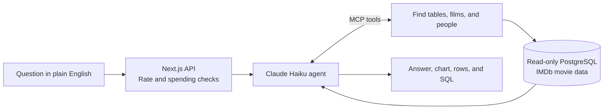

# Cinequery

**Ask questions about 49,466 IMDb films in plain English. An AI agent queries PostgreSQL and returns an answer, a chart, and the SQL behind it.**

https://github.com/user-attachments/assets/5c0f0127-aef6-40b1-b16d-9d601e8364d1

Built by [Logan Li](https://www.linkedin.com/in/logan-li-9089b7216/) · [Saved evaluation results](evals/results/) · [Deployment guide](docs/DEPLOYMENT.md)

## What it is

Which Christopher Nolan film is rated highest? Are movies getting longer?
Which directors have made six films rated 8.0 or better? Cinequery lets you
ask those questions without writing a database query yourself.

Type a question and click **Ask question**, or click an example card. The
agent looks up the relevant films and people, writes SQL, and runs it against
IMDb data. You can follow its tool calls as it works, then inspect the answer,
chart, returned rows, and exact query.

- **Compare:** ratings, genres, directors, and casts, with vote thresholds you choose.
- **Explore trends:** average runtimes or ratings by year and decade.
- **Check the evidence:** expand the SQL and rows instead of taking the answer on trust.
- **See how it scores:** the Accuracy page shows all four agent versions on the same 100 questions, including every failed answer.

The database contains feature films with at least 1,000 IMDb votes. It is a
stored dataset, not a live IMDb search; it does not include streaming
availability or personalized viewing history.

## How it works



1. **Data.** The loader filters IMDb's public datasets into four tables:
   movies, ratings, people, and credits. The saved run used **49,466 films,
   138,864 people, and 388,558 credits**. Column comments explain units,
   missing values, and how to join the tables.
2. **Discovery through MCP.** The agent can list tables, read their schemas,
   search people and titles, and run SQL. It discovers the data through tools
   rather than receiving the whole schema in the initial prompt.
3. **A bounded agent loop.** Claude gets up to eight data-tool calls before
   submitting an answer, SQL, and chart specification. A 90-second deadline
   bounds the model loop.
4. **Database-backed results.** The server runs the final SQL again. Those
   rows supply the table, chart, and evaluation scorer; the model cannot
   substitute invented rows for database output.
5. **One server, two interfaces.** The site uses MCP in-process. The same
   tools can run over stdio for a local MCP client. See [MCP setup](docs/MCP.md).

## Results

Each version answered the same **100 questions**, with 20 each covering
single-table queries, joins, aggregation, ambiguous names, and trends. We
compare the agent's final database rows with a reference SQL query, allowing
column names to differ and checking row order when the question requires it.

<!-- evals:start -->
| Version | Change | Correct | Avg. tool calls | Median latency | Median API cost |
| --- | --- | ---: | ---: | ---: | ---: |
| v1 | list_tables, describe_table, run_query only | **77%** (77/100) | 4.3 | 5.3 s | $0.00078 |
| v2 | Column comments and sample rows in describe_table | **79%** (79/100) | 4.0 | 5.0 s | $0.00086 |
| v3 | Add search_people and search_titles | **77%** (77/100) | 3.7 | 4.8 s | $0.00088 |
| v4 | 3 worked examples in the system prompt | **82%** (82/100) | 2.9 | 4.6 s | $0.00093 |

Model: claude-haiku-5-5, effort medium. 100 questions, 20 per category.
Largest observed increase: v3 → v4 (+5 points), from "3 worked examples in the system prompt".
<!-- evals:end -->

These are single-run results on the saved dataset, not a guarantee for every
movie question. All 18 failures in v4 had the wrong number of result rows:
17 returned too many, and one returned too few. They remain failures in the
published scores.

The v4 run cost approximately **$0.095**; all four versions together cost
approximately **$0.37** in recorded API usage. Full per-question results,
queries, category scores, timing, and token counts are saved in
[`evals/results/`](evals/results/).

## Engineering highlights

- **Measured the changes, including regressions.** Schema comments and
  sample rows raised the score from 77% to 79%. Adding name-search tools
  scored 77% in its run. Three worked examples brought v4 to 82%, with
  average tool calls falling from 4.3 in v1 to 2.9 in v4.
- **The database enforces read-only access.** A dedicated reader role,
  read-only transactions, a five-second statement timeout, and a 200-row
  output limit sit behind the SQL guard. The guard also checks quoted
  function names and rejects multi-statement queries.
- **Limits hold under simultaneous requests.** Admission checks and inserts
  share a transaction lock across server instances. Defaults are ten
  questions per IP per hour and two in-flight questions globally. A $0.50
  daily estimated-spend threshold complements the provider's account limit;
  it is a soft cap because already-running calls can finish above it.
- **Idle browsing does not query the database.** The homepage and Accuracy
  page are static. Connections open on demand and idle sockets close after
  five seconds. There are no background SQL pings, polling jobs, or automatic
  evaluations to keep Neon awake.
- **Production fails closed.** Missing request-accounting credentials, weak
  IP salts, owner-role connection strings, or Neon URLs without SSL block
  API requests. Input size, JSON shape, and browser origins are checked
  before a database connection opens.
- **94 tests**, including real PostgreSQL permission/timeout checks,
  concurrent admission, idle connection closure and reconnection, and
  malformed request handling. CI runs without production secrets or paid
  model calls. Integration tests skip when a local database is absent.

Security controls and their limitations are documented in
[SECURITY.md](SECURITY.md). The recorded dependency audit found no known
advisories; that is not a claim that the application has no vulnerabilities.

## Built with

TypeScript · Next.js · React · Claude Haiku 5.5 · Model Context Protocol ·
PostgreSQL · Recharts · Tailwind CSS · Node.js

## Status

The demo above was recorded locally. The movie database has been migrated to
Neon and verified against the local copy. The app is prepared for Vercel; a
public deployment URL has not been added yet.
[Deployment steps](docs/DEPLOYMENT.md) cover migrating the existing dataset,
setting up the restricted roles, and configuring the server-only secrets.

The repository includes source code and saved evaluations. Database dumps,
API keys, and local request history are not included. The included IMDb
loader downloads a fresh dataset; preserving the exact evaluated dataset
requires migrating the existing database instead.

## Run it locally

Requires **Node 24**, **pnpm 10.27.0**, and, for questions, PostgreSQL 16+ with
`pg_trgm` and an Anthropic API key.

Preview the interface without a database or model key:

```bash
pnpm install --frozen-lockfile
cp .env.example .env
pnpm dev                          # http://localhost:3100
```

To answer questions, create a fresh local database and fill in `.env` with
its admin URL, separate reader/ops role passwords and connection strings,
a private IP salt, and your Anthropic key. Then initialize it:

```bash
createdb cinequery
pnpm db:load                      # downloads IMDb data; recreates the movie tables
pnpm db:ops                       # request accounting and spending checks
pnpm db:roles                     # restricted reader and ops roles
pnpm eval:check-gold               # checks reference SQL; no model calls
pnpm dev
```

Use `db:load` only for a fresh dataset. To retain the data behind the saved
scores, follow the [migration guide](docs/DEPLOYMENT.md) instead.

Run the checks:

```bash
pnpm test
pnpm build
```

`pnpm eval --version v4` runs the 100-question evaluation and makes paid model
calls. `pnpm eval:report` updates the results table above from the saved JSON
without calling the model. Deployment builds run neither command.

## Repository layout

| Path | Contents |
| --- | --- |
| [`src/app/`](src/app/) | Ask page, Accuracy page, and streaming question API |
| [`src/components/`](src/components/) | Question form, live tool trace, charts, SQL, and result tables |
| [`src/agent/`](src/agent/) | Agent loop, prompts, four versions, and estimated token costs |
| [`src/mcp/`](src/mcp/) | MCP tools, in-memory server, and stdio entry point |
| [`src/lib/`](src/lib/) | Database access, SQL guard, admission controls, and request validation |
| [`db/`](db/) | Movie schema, indexes, and request-accounting schema |
| [`evals/`](evals/) | Questions, reference SQL, scorer, runner, and saved results |
| [`scripts/`](scripts/) | IMDb loader, role setup, terminal questions, and evaluation helpers |
| [`docs/`](docs/) | [Deployment](docs/DEPLOYMENT.md), [Neon idle behavior](docs/NEON.md), [MCP setup](docs/MCP.md), and [build log](docs/PROGRESS.md) |

## License

Original code is under the [MIT License](LICENSE). IMDb data retains its
[non-commercial dataset terms](https://developer.imdb.com/non-commercial-datasets/).
Photographs, the Interstellar still, and fonts retain their respective rights
and are not covered by the code license. See [third-party notices](THIRD_PARTY_NOTICES.md).
Cinequery is not affiliated with IMDb or TMDB.
